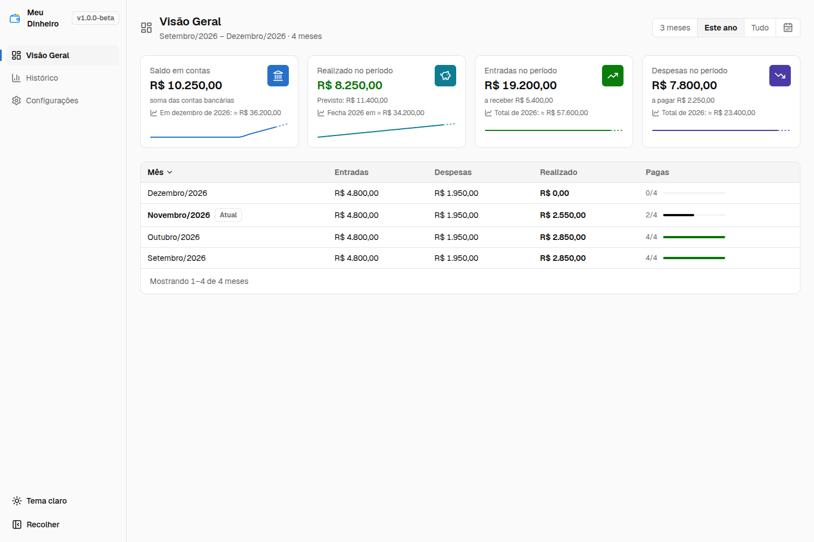

# Meu Dinheiro

Aplicativo desktop de controle financeiro pessoal organizado por mês. Cadastre
aluguel, salário e outras despesas e entradas recorrentes; acompanhe pagamentos,
recebimentos, comprovantes e saldos em uma interface em português.

Os dados ficam no computador, em SQLite e numa pasta de comprovantes, sem conta
online ou servidor do aplicativo. Você pode exportá-los para um ZIP.
Consulte os [limites e cuidados com os dados](docs/storage.md).



**Demonstração:** todas as capturas usam dados inteiramente fictícios de setembro
a dezembro de 2026. Valores e nomes não representam pessoas ou contas reais.
Veja as [demais telas e o cenário](docs/screenshots.md), incluindo o tema escuro.

## Instalação

A pré-release **1.0.0-beta.1** oferece um instalador para **Linux x64
(Debian/Ubuntu, `.deb`)**:

1. Na [página da release](https://github.com/kvojps/meu-dinheiro-app/releases/tag/v1.0.0-beta.1),
   baixe `meu-dinheiro-1.0.0-beta.1-linux-x64.deb` e `SHA256SUMS`.
2. Na pasta dos downloads, confira a integridade e instale:

   ```bash
   sha256sum -c SHA256SUMS
   sudo apt install './meu-dinheiro-1.0.0-beta.1-linux-x64.deb'
   ```

Antes de atualizar, [exporte um backup](docs/storage.md). O deb não possui
assinatura digital; SHA-256 confere os bytes, sem autenticar autoria.

Abertura direta, navegação, persistência e backup/restauração com caminhos de
diálogo automatizados foram conferidos em Ubuntu 26.04.1 LTS x64. Instalação
limpa, continuidade de perfil anterior, seletores nativos completos, abertura
pelo menu e comprovante válido em leitor externo não foram ensaiados; essas
limitações foram aceitas pelo mantenedor. Consulte o [guia de instalação](docs/installation.md)
e as notas da release antes de instalar. Não há garantia de downgrade.

**Windows:** fora desta pré-release. Não há instalador independente oferecido
nem validação nesse sistema; a configuração NSIS existente é experimental.
Não há instruções validadas para macOS ou outras arquiteturas.

Para executar o código localmente, veja [Desenvolvimento](docs/development.md).

## Primeiros passos

1. Abra **Configurações → Contas bancárias** e cadastre uma conta com seu saldo inicial.
2. Em **Categorias**, ajuste a classificação das despesas.
3. Cadastre **Despesas padrão** e **Entradas padrão**. Os padrões são copiados
   para meses novos; cadastrar um padrão também o acrescenta aos meses existentes.
4. Em **Adicionar Meses**, escolha o intervalo que quer acompanhar.
5. Na **Visão Geral**, abra um mês, use **Pagar** ou **Receber** e confira as
   datas, a conta e os valores. O mês corrente é criado automaticamente.
6. Consulte o **Histórico** e exporte um backup em **Configurações → Backup**.

## Guias

- [Manual de uso](docs/user-guide.md)
- [Instalação e conferência dos candidatos](docs/installation.md)
- [Armazenamento, backup e restauração](docs/storage.md)
- [Desenvolvimento](docs/development.md)
- [Arquitetura](docs/architecture.md)
- [Capturas de demonstração](docs/screenshots.md)

## Licença

Código sob a [licença MIT](LICENSE). Bibliotecas e recursos de terceiros mantêm
suas próprias licenças e atribuições em [THIRD-PARTY-NOTICES.md](THIRD-PARTY-NOTICES.md).
