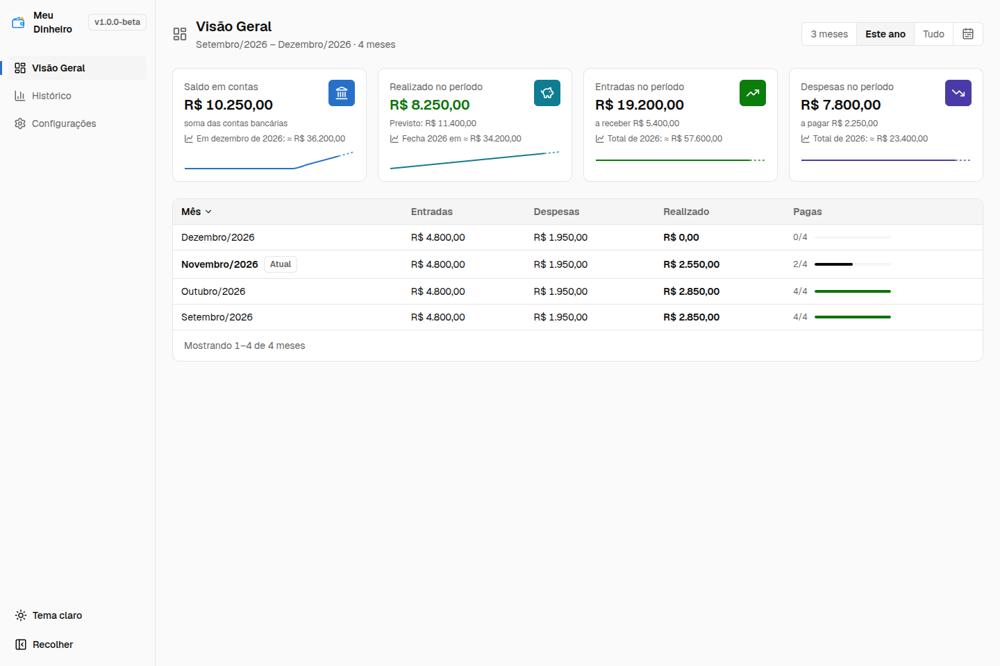
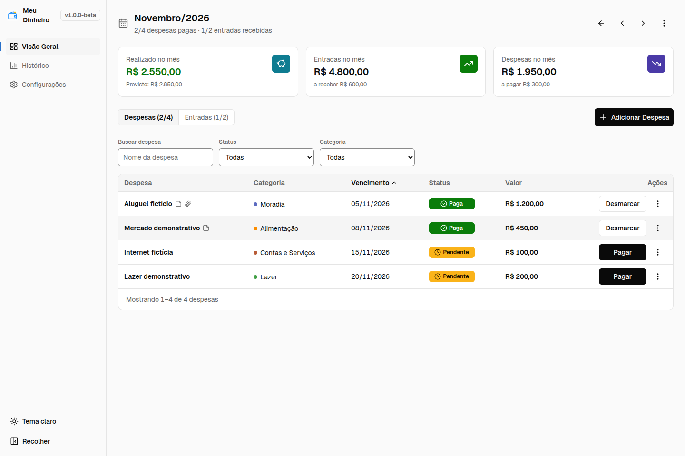
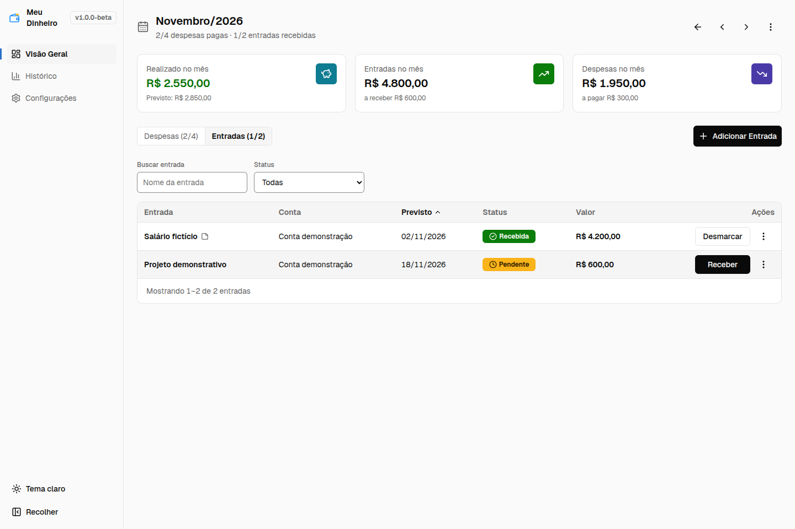
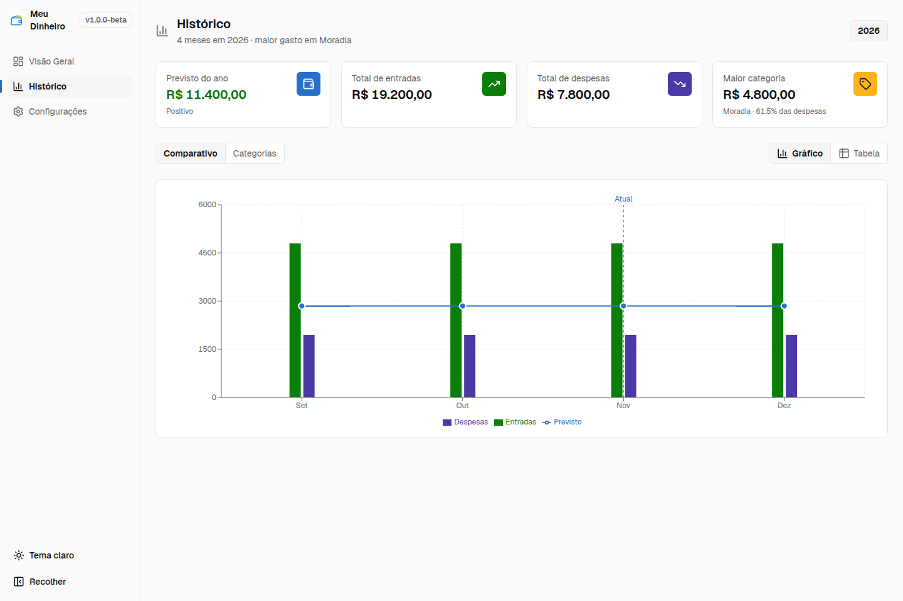
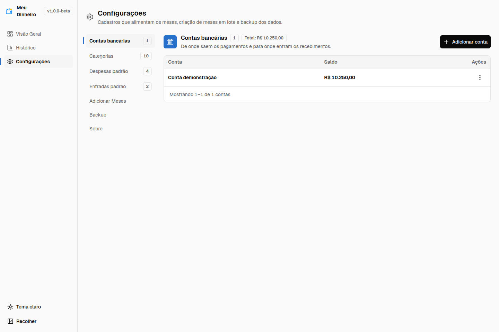
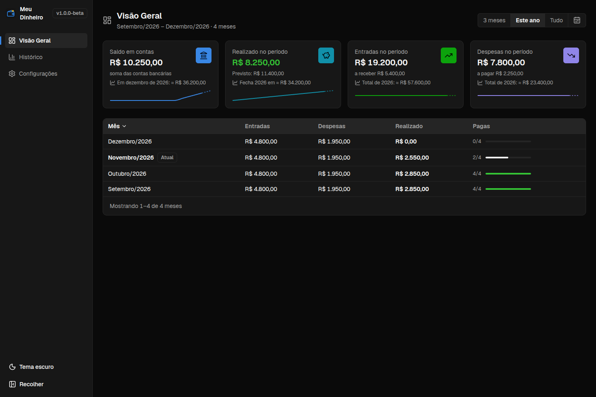

# Capturas de demonstração

[Início](../README.md) · [Manual](user-guide.md)

Todas as imagens abaixo são capturas reais do bundle Electron em Linux x64,
realizadas em 2026-11-10, com área de conteúdo de 1440 × 960 e tema claro como
padrão. O perfil foi criado exclusivamente para demonstração, fora do repositório.
Nenhum dado, backup ou log pessoal foi utilizado. Não são imagens geradas.

## Visão Geral

## Mês — despesas e entradas

## Histórico

## Configurações

## Tema escuro

## Cenário e conferência

Há quatro meses, de setembro a dezembro de 2026, com os mesmos padrões fictícios:
aluguel de R$ 1.200, mercado de R$ 450, internet de R$ 100 e lazer de R$ 200;
salário de R$ 4.200 e projeto de R$ 600. Cada mês tem R$ 4.800 de entradas,
R$ 1.950 de despesas e R$ 2.850 previstos. Setembro e outubro estão quitados;
novembro tem R$ 4.200 recebidos e R$ 1.650 pagos, portanto R$ 2.550 realizados;
dezembro está pendente. O saldo inicial fictício da conta é R$ 2.000.

Assim, a conta demonstração soma R$ 10.250, o realizado do período é R$ 8.250
e o previsto é R$ 11.400. O Histórico usa os totais previstos dos meses
cadastrados, enquanto projeções da Visão Geral estimam também meses ausentes.
As datas/status correspondem à data da captura; não representam uma conta real.

Os PNGs guardam somente pixels, sem campos textuais, EXIF ou caminhos de perfil.
Foram revisados nomes, valores, consistência entre telas e legibilidade. Para
refazer, use um perfil novo, reproduza os cadastros fictícios e capture a área do
aplicativo após carregar fontes e gráficos; não use o perfil pessoal. O ZIP do
ensaio e os arquivos internos do perfil não acompanham as imagens.
